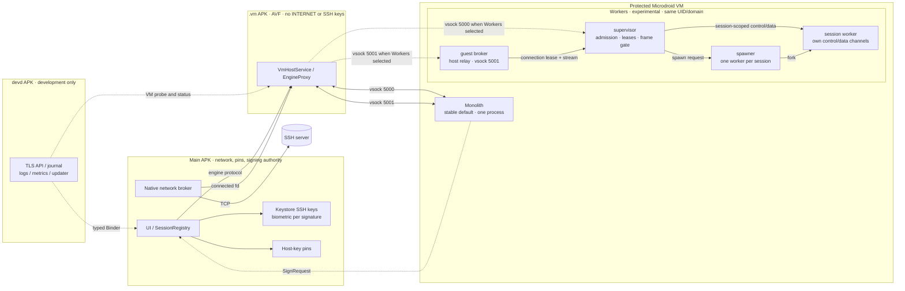

# Veil Terminal

An Android SSH workstation built around nested security boundaries: separate Android packages, a
protected Microdroid VM, and the access and authority boundaries inside it. In VM mode, remote-facing
SSH and terminal code runs in a protected Microdroid guest; the main app
retains network dialing, host-key policy and Keystore signing. Each SSH-key signature requires strong
biometric authorization, and SSH private keys never enter the guest. A separate `.vm` Android
package hosts the VM with AVF permissions but no `INTERNET` or SSH keys. The native engine remains an
explicit fallback, never a silent substitution.

Inside that same VM, the experimental **Workers** layout narrows each session worker's access to its
own control/data channels. A supervisor owns session admission, connection leases and frame
validation, rejecting cross-session messages and treating worker output as untrusted; a separate
guest broker handles the host network relay, and a dedicated spawner creates one short-lived worker
per SSH session. Workers receive neither vsock listeners nor other sessions' descriptors. These are
protocol-enforced authority and capability boundaries — who may dial, own a lease, sign, or emit
frames for a session — plus deliberately limited descriptor grants, not merely crash containment.
They are not kernel-enforced tenant isolation: all Workers processes share the
guest UID (6000 on the tested build) and one SELinux domain, so same-UID signals and denial of
service remain possible. In `v0.1.0`, **Monolith** is the stable default; **Workers** is selectable
and experimental.

The current stable release is `v0.1.0`, validated on a Pixel 8 running GrapheneOS.



Guest-internal gates restrict protocol access; they do not provide per-role UID isolation.

Today the main app still holds `INTERNET` and the SSH signing authority. The planned `.net` package
will own networking and `.vault` will own key use; neither is part of this release.

## What it does

- SSH with password, keyboard-interactive or key login. Keys are ECDSA P-256 in Android Keystore,
  using StrongBox by default where available; new keys require strong-biometric authentication for
  each signature. The engine never sees a private key.
- Optional SSH bastion / jump host profiles. The first TCP stream goes to the bastion and the
  worker opens a direct-tcpip channel to the final target.
- Experimental **Workers** layout: session-scoped channels and supervisor-enforced admission, lease
  matching and frame validation limit each worker's authority inside one VM. Processes share the
  guest UID and SELinux domain; this is not kernel-enforced tenant isolation. **Monolith** remains
  the stable default.
- Post-quantum hybrid key exchange (`mlkem768x25519-sha256`) by default, with classical only for
  explicitly allowed hosts.
- Host keys are pinned by the app for both native and VM sessions; a changed key is refused.
- A real terminal: true color, mouse, bracketed paste, scrollback, pinch-to-resize, fullscreen,
  notch coverage, themes, and copy-only OSC 52. The bundled **Hack Nerd Font Mono** gives
  shell prompts, tmux, and editor icons the glyphs they expect without requiring a device font.
- Sessions continue in the background; the VM host is a foreground service.
- VM host metrics, VM console logs and guest uptime are exposed through devd and `veil-ctl`.
- Native engine choice remains available for comparison and recovery; VM failure is reported, not
  hidden.

## Install

For VM mode, install both APKs and grant the one-time AVF permissions:

```sh
scripts/grant-avf
```

Then open Veil → Settings → Engine → **VM (Microdroid)** and restart Veil. Native mode needs only
the main APK. `devd` and the dev APK are development tools and are not required in production.

## Repository map

| Path | What |
|---|---|
| `proto/`, `core/protocol` | Engine protocol schema and checked Rust types |
| `core/engine` | SSH sessions, prompts, framing, rendered frames |
| `core/term` | Terminal emulation boundary |
| `core/caps` | `Dialer`, `HostKeyStore` capability traits |
| `core/obs` | Log rings, counters, process metrics |
| `guest/engine-host` | Engine on a stream; the native host and the VM payload's core |
| `guest/vm-engine` | Microdroid Monolith payload and guest broker |
| `guest/vm-engine-workers` | Experimental same-VM supervisor, broker, spawner and per-session workers |
| `guest/vm-probe` | Dev-only Microdroid capability and tenant probe |
| `android/app` | Main APK: UI, session coordination, Keystore signer, host-key pins |
| `android/vm` | `.vm` APK: AVF host, VM lifecycle, relay, VM metrics |
| `android/engine-client` | Kotlin engine protocol, backends, native broker |
| `android/devd`, `android/devapi`, `dev/ctl` | Development control plane and laptop CLI |
| `docs/design/0001-component-layout.md` | Current and planned component boundaries |

## Build

```sh
scripts/build all           # app dev + prod, devd, .vm APK
scripts/sign prod           # sign and verify the release APK
scripts/sign dev            # dev APK, with DevHooks
scripts/sign vm             # VM host APK
scripts/sign devd           # development agent
scripts/ctl --install       # veil-ctl into dist/ and ~/.local/bin
```

`scripts/build` and `scripts/sign` run in the pinned build environment. Rust checks and Android
tests are described in [docs/dev-control.md](docs/dev-control.md).

## Verify a release

Every release is signed with the pinned Veil key and carries checksums, third-party notices, an
SPDX SBOM and GitHub attestations.

```sh
sha256sum -c SHA256SUMS
gh attestation verify <file> -R franticplant/veil-terminal
```

More: [component layout](docs/design/0001-component-layout.md),
[guest decomposition and its security limits](docs/design/0005-guest-decomposition.md),
[threat models](docs/security/0001-threat-models.md),
[development control](docs/dev-control.md),
[release notes](docs/release-notes/v0.1.0.md).

## License

Apache-2.0. Dependencies are limited to permissive licenses by `deny.toml`.
